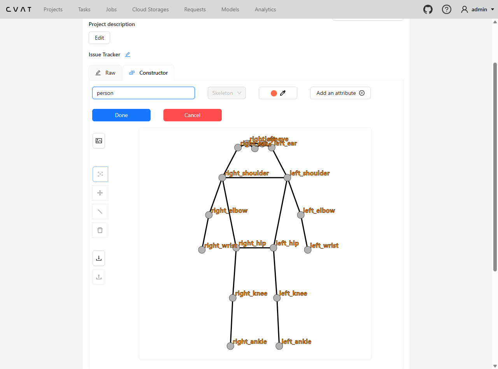
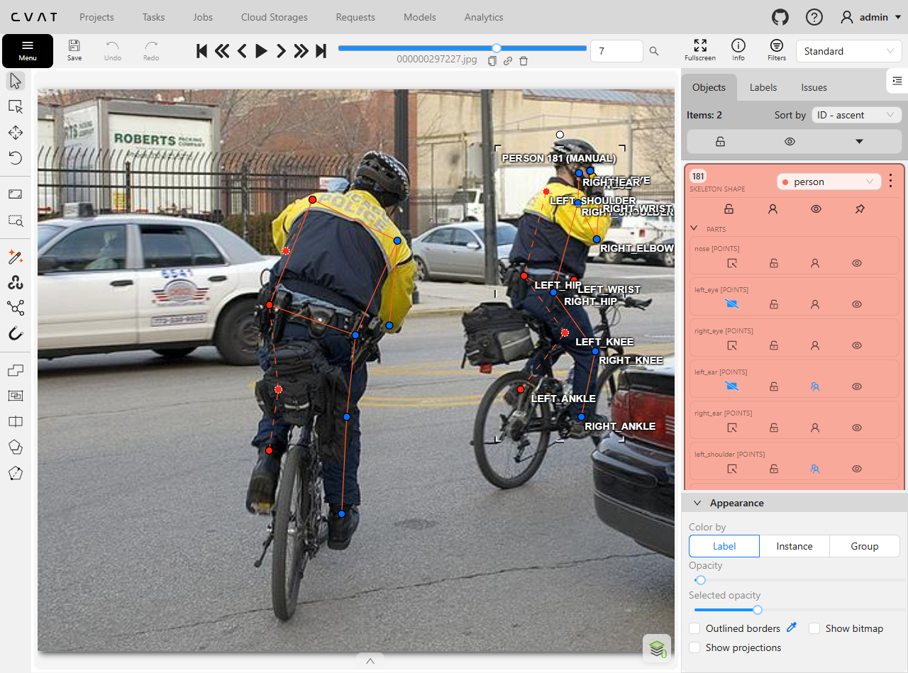
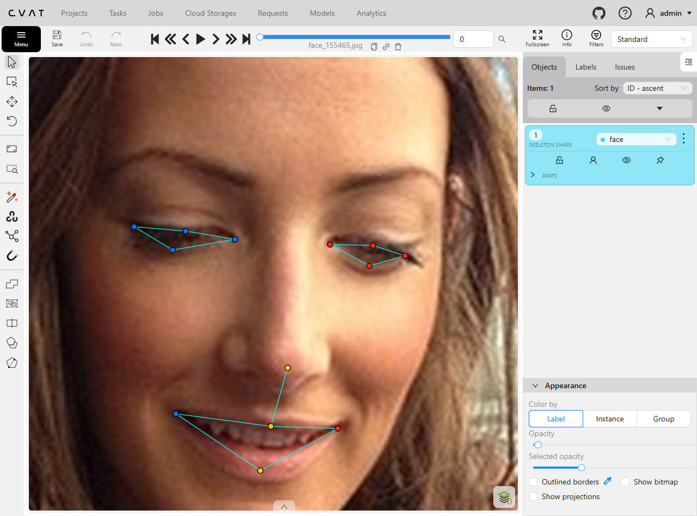
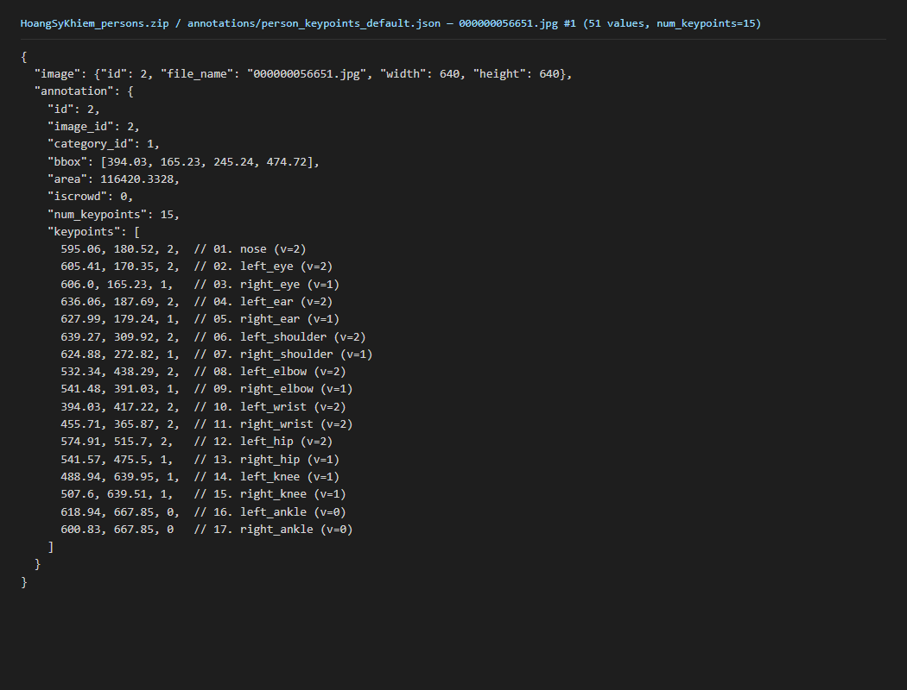

# Báo cáo cá nhân — HoangSyKhiem-2A202603244

Đổi tên file theo quy tắc `MSSV_HoTen.md`. Ví dụ: `20241234_NguyenVanAn.md`.

Dữ liệu: 12 ảnh người COCO val2017 (Lin et al., 2014) và 8 ảnh chân dung Wikimedia Commons, chỉ dùng trong lớp.

## 0. Thông tin học viên

- Họ tên: Hoang Sy Khiem
- MSSV: 2A202603244
- Email: hoangsikhiem3523@gmail.com
- Link repository: https://github.com/hoangkhiem3523/K5-L2-DAY04-HoangSyKhiem-2A202603244-KeypointPose
- Phiên bản CVAT (Help → About): 2.82.1
- Máy: hệ điều hành Windows 11 Home Single Language · RAM 16 GB · chạy CVAT chế độ đầy đủ
- Bộ ảnh (`src/exports/assignment.json` do `lab.py setup` tạo): có
- Giờ bắt đầu: 17:25 (12/11/2026)
- Giờ kết thúc: 18:27 (12/11/2026)

## 1. Kiểm tra label (CP0)

| Label | Kiểu | Số điểm | Tên điểm đúng bảng của lab? | Đúng thứ tự? | Số cạnh |
|---|---|---:|---|---|---:|
| `person` | Skeleton | 17 | Có | Có | 19 |
| `face` | Skeleton | 13 | Có | Có | 13 |

Mẫu `person` dựng theo người quay mặt về camera (các điểm `left_*` nằm bên phải khung mẫu)? Có

Cách đổi cờ `occluded` / `outside` cho **một điểm** trên phiên bản CVAT này (một câu):

Rê chuột vào đúng điểm cần đổi rồi bấm `Q` (`occluded`) hoặc `O` (`outside`), hoặc chuột phải vào điểm đó để chọn trong menu.

## 2. Số lượng đã gán và thời gian (CP1, CP2)

| Nhóm ảnh | Số ảnh | Số skeleton đã gán | Số người dưới 60 px (không gán) | Số poster / gương / màn hình bỏ qua | Thời gian (phút) |
|---|---:|---:|---:|---:|---:|
| `easy` | 5 | 5 | 1 | 0 | (gộp CP1+CP2 ~62′) |
| `occluded` | 3 | 6 | 0 | 1 | |
| `back` | 2 | 4 | 1 | 0 | |
| `small` | 1 | 2 | 0 | 0 | |
| `crowd` | 1 | 3 | 1 | 0 | |
| `faces` | 8 | 8 | — | 0 | |

- Số ảnh người đã xong ở mốc phút 105: 10 / 10 (hoàn thành đủ 12/12 ảnh trong ~62 phút)
- Thời gian thực tế (phút): CP1 + CP2 ~62′ (17:25–18:27) · CP3 ~1′
- Ảnh tốn thời gian nhất là ảnh nào, vì sao?

`000000393909.jpg` (nhóm `occluded`, có 2 người bị che khuất nên mất nhiều thời gian căn khớp và đặt cờ visibility).

## 3. Bảng ca khó (CP1, CP2)

Mỗi điểm bạn phân vân một dòng, nhất là phân vân giữa `v = 1` và `v = 0`, hoặc không chắc hướng người.

| Ảnh | Người / mặt | Điểm | Cờ đã chọn | Phân vân giữa | Lý do chọn |
|---|---|---|---:|---|---|
| `000000078170.jpg` | Person #1 | `left_knee`, `right_knee` (vùng đùi/gối) | `v = 1` | `v = 1` và `v = 0` | Phần đùi/gối bị che khuất khá khó đoán, nhưng vẫn ước lượng được theo trục chân nên chọn `occluded` (`v = 1`). |
| | | | | | |
| | | | | | |

## 4. Bảng tự review (CP3)

Đi từ ảnh cuối về ảnh đầu. 5 ảnh người (ít nhất 2 ảnh `back` hoặc `crowd`) và 3 ảnh mặt. Ít nhất 8 dòng, kể cả dòng `ok`. Ghi lỗi trước, sửa sau.

Mã lỗi dùng đúng một trong: `lr_swap`, `vis_flag`, `position`, `missing`, `extra`, `ok`.

| Ảnh | Người / mặt | Điểm | Mã lỗi | Ghi chú | Đã sửa? |
|---|---|---|---|---|---|
| `face_219250.jpg` | Face #1 (kính râm) | 8 điểm mắt (`left_eye_*`, `right_eye_*`) | `vis_flag` | Ban đầu để `v = 2`, rà lại thấy đeo kính râm nên đổi sang `occluded` (`v = 1`). | Có |
| `000000309169.jpg` | Person #3 (`crowd`) | Toàn thân (17 điểm) | `missing` | Ban đầu sót 1 người cao ~84 px (`>= 60 px`), đã gán bổ sung đủ 17 điểm. | Có |
| `000000508269.jpg` | Person #1 (`easy`) | Toàn thân (17 điểm) | `extra` | Gán nhầm 1 người cao ~42 px (`< 60 px`), kiểm lại và đã xóa khỏi job. | Có |
| `000000461002.jpg` | Person #1 (`back`) | `hip`, `knee`, `ankle` | `ok` | Kiểm tra lại cảnh báo ngược phía: đúng trái/phải theo tư thế vặn người. | Không cần sửa |
| `000000297227.jpg` | Person #1, #2 (`back`) | Toàn thân, cờ `occluded`/`outside` | `ok` | Kiểm tra lại 2 người quay lưng: cặp `left_*`/`right_*` và cờ `v` đặt đúng hướng. | Không cần sửa |
| `000000056651.jpg` | Person #1 (`occluded`) | `wrist`, khớp sát biên | `ok` | Kiểm tra lại cảnh báo: tay vắt chéo và khớp nằm sát biên ảnh thực tế. | Không cần sửa |
| `face_155465.jpg` | Face #1 (`thang`) | 13 điểm mắt, mũi, miệng | `ok` | Kiểm tra 13 điểm đặt đúng mép mí mắt, đầu mũi và khóe miệng. | Không cần sửa |
| `face_185015.jpg` | Face #1 (`nghieng`) | 13 điểm mắt, mũi, miệng | `ok` | Kiểm tra đủ 13 điểm mặt nghiêng, đúng trái/phải theo người trong ảnh. | Không cần sửa |

Tổng hợp số lỗi theo mã:

| `lr_swap` | `vis_flag` | `position` | `missing` | `extra` | `ok` |
|---:|---:|---:|---:|---:|---:|
| 0 | 1 | 0 | 1 | 1 | 5 |

Điểm còn phân vân giữa `v = 1` và `v = 0` (ghi cả hai lựa chọn và lý do chọn):

Không còn điểm phân vân.

## 5. Kiểm file xuất và kết quả tự kiểm (CP4)

Tự kiểm tay trong file JSON:

| File | Người / mặt kiểm (ảnh, thứ tự) | Số phần tử `keypoints` | Điểm `outside` ra `v = 0`, `occluded` ra `v = 1`? | `num_keypoints` khớp? |
|---|---|---:|---|---|
| `HoangSyKhiem_persons.zip` | `000000021235.jpg`, #1 (`ann_id: 1`) | 51 | Có (17 điểm `v = 2`) | Có (`17`) |
| `HoangSyKhiem_persons.zip` | `000000056651.jpg`, #1 (`ann_id: 2`) | 51 | Có (2 điểm `v = 0`, 7 điểm `v = 1`, 8 điểm `v = 2`) | Có (`15`) |
| `HoangSyKhiem_faces.zip` | `face_155465.jpg`, #1 (`ann_id: 1`) | 39 | Có (13 điểm `v = 2`) | Có (`13`) |

Sau khi xuất, CVAT ghi `occluded` thành `v = 1` và `outside` thành `v = 0`. Tọa độ của điểm `outside` trong file là `0, 0` hay tọa độ cũ? Tọa độ cũ (ví dụ `(618.94, 667.85, 0)` ở `000000056651.jpg` #1).

Hai job đã chuyển sang completed trên CVAT? Có

Dán phần **TÓM TẮT** in ra từ `src/check_submission.py`:

```text
- File person: HoangSyKhiem_persons.zip
  Số ảnh: 12 · số skeleton `person`: 20 · mỗi annotation 51 số
  Skeleton theo ảnh: 000000021235=1, 000000056651=2, 000000078170=2, 000000106051=2, 000000196283=1, 000000240340=1, 000000261732=1, 000000297227=2, 000000309169=3, 000000393909=2, 000000461002=2, 000000508269=1
  Cờ v: v=2 261 (77%) · v=1 53 (16%) · v=0 26 (8%)
  num_keypoints trung bình: 15.7
- File face: HoangSyKhiem_faces.zip
  Số ảnh: 8 · số skeleton `face`: 8 · mỗi annotation 39 số
  Skeleton theo ảnh: face_155465=1, face_168953=1, face_185015=1, face_219250=1, face_223746=1, face_3348=1, face_380639=1, face_79367=1
  Cờ v: v=2 96 (92%) · v=1 8 (8%) · v=0 0 (0%)
  num_keypoints trung bình: 13.0
- Ghi chú: 26 điểm v = 0 vẫn mang tọa độ cũ (CVAT 2.x xuất như vậy; chuẩn COCO ghi 0, 0). Không phải lỗi: điểm v = 0 bị bỏ qua khi huấn luyện và khi chấm.
- Số [LỖI]: 0 · số [CẢNH BÁO]: 7
Kết quả: ĐẠT (đọc lại từng cảnh báo ở trên)
```

Các `[CẢNH BÁO]` còn giữ nguyên và lý do:

- `000000056651.jpg #1` (`wrist`), `000000309169.jpg #2` (`hip, knee, ankle`), `000000461002.jpg #1` (`hip, knee, ankle`), `000000508269.jpg #1` (`ankle`): đã kiểm tra lại trên ảnh gốc, đây là tư thế vặn người / tay chân bắt chéo thật nên cặp điểm trái/phải chéo phía nhau, không phải lỗi `lr_swap`.
- `000000056651.jpg #1` (`left_shoulder` `v=2` tại `(639, 310)`, `left_knee` `v=1` tại `(489, 640)`, `right_knee` `v=1` tại `(508, 640)`): điểm khớp nằm ngay sát biên ảnh thực tế nên giữ nguyên.

## 6. Ảnh chụp màn hình

1. Label `person` trong label constructor (đủ 17 điểm có tên):

   

2. Một người quay lưng đã gán, cờ đã đặt:

   

3. Một khuôn mặt đã gán 13 điểm, phóng to vùng mắt:

   

4. Một đoạn JSON xuất của một người:

   

Nguồn ảnh: COCO val2017 / Wikimedia Commons.

## 7. Tự đánh giá

1. Lỗi bạn mắc nhiều nhất hôm nay, và cách bạn sẽ tránh ở dự án thật:

   Lỗi gặp hôm nay là sót/thừa người quanh ngưỡng 60 px (`missing` ở `000000309169.jpg`, `extra` ở `000000508269.jpg`) và quên bật `v = 1` cho mắt sau kính râm (`face_219250.jpg`). Cách tránh ở dự án thật: rà theo checklist ngưỡng kích thước tối thiểu và cờ visibility cho các ca đặc biệt trước khi kết thúc job.

2. Một quy tắc bạn đề xuất thêm vào guideline (kèm ảnh ví dụ nếu có):

   Bổ sung trong guideline (và chú thích của script tự kiểm) ví dụ minh họa tư thế người chạy vặn hông hoặc tay/chân bắt chéo thật, để người gán phân biệt rõ với lỗi `lr_swap` thay vì nhầm là cảnh báo sai nhãn.

3. Nhãn của bạn đi vào model ở đâu? Chọn một lỗi bạn đã sửa và nói nó sẽ làm model học sai thế nào (heatmap, trọng số trong loss, hay bước lật ảnh):

   Chọn lỗi `vis_flag` (để `v = 2` thay vì `v = 1` ở mắt sau kính râm): mỗi điểm `v > 0` tạo một đỉnh trên heatmap và được tính trọng số vào hàm loss; nếu giữ `v = 2`, model học nhầm bề mặt kính tối là tâm mắt nhìn rõ, nên cần đặt `v = 1` để đúng bản chất bị che nhưng ước lượng được.

## 8. Khó khăn và lỗi kỹ thuật

- CVAT 2.82.1 trên Docker local chạy ổn định, không gặp lỗi hệ thống.
- Khi chạy `src/check_submission.py`, một số ảnh tư thế chạy/vặn người hoặc có khớp sát biên bị báo `[CẢNH BÁO]` nên phải mở lại CVAT để đối chiếu xác nhận.

## Bonus (nếu làm)

Không thực hiện.

## 9. Tài liệu tham khảo và công cụ AI đã dùng

- Tài liệu lab: `README.md`, `docs/GUIDELINE.md`, `docs/CVAT_CHEATSHEET.md`, `docs/COCO_KEYPOINTS.md`.
- Công cụ AI (Antigravity): hỗ trợ thiết lập repo/git, chạy `lab.py check` và `lab.py export`, kiểm tra kết quả `src/check_submission.py`, chụp 4 ảnh minh họa từ CVAT/JSON và tổng hợp câu chữ báo cáo dựa trên dữ liệu gán và trao đổi thực tế.
